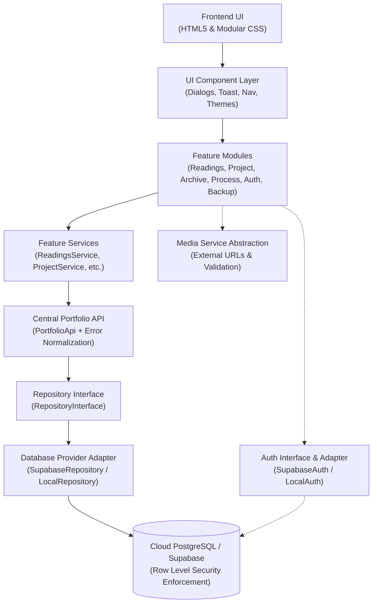

# Deepak — Digital Humanities Portfolio (Modular Architecture)

> **Course**: ENG101-2B · Introduction to Digital Humanities  
> **Student**: Deepak (2633115) · BA English, Semester II, 2026–27  
> **Institution**: CHRIST (Deemed to be University), Department of English and Cultural Studies

---

## 1. Project Architecture

This project is a professional, modular, and scalable restructuring of the Digital Humanities portfolio website.

The application follows an **independent layered architecture** where visual styling, feature modules, service coordination, and cloud infrastructure are completely decoupled. Any provider (Supabase, Firebase, AWS, or local storage) can be swapped without modifying UI code or feature logic.



### Key Architectural Principles
- **Visual Invariance**: The typography, color schemes, animations, responsiveness, and layout match the original design 100%.
- **Zero Frontend Frameworks**: Pure vanilla JavaScript (ES modules), HTML5, and CSS3.
- **Provider Independence**: Frontend code never directly calls database SDKs or tables.
- **No Insecure Storage**: No arbitrary base64 image strings embedded into the database. External media URLs are used with safe link attributes.
- **Database Security**: Enforced using PostgreSQL Row Level Security (RLS) with UUID ownership checking. Public visitors can view; only the authenticated owner can write.
- **Clean Save-and-Refresh Cycle**: No complex WebSockets, real-time channels, or background polling. Updates are persisted atomically to the cloud database on save.

---

## 2. Folder Structure

```
deepak/
├── backup/
│   └── Deepak_2633115.original.html        # Verified original single-file backup
├── database/
│   ├── migrations/
│   │   ├── 001_create_portfolio_tables.sql  # Schema version 1 table & indexes
│   │   └── 002_security_and_rls_policies.sql# PostgreSQL Row Level Security policies
│   └── README.md                           # Database setup instructions
├── src/
│   ├── api/
│   │   └── portfolio-api.js                # Central API contract & unified errors
│   ├── backend/
│   │   ├── auth/
│   │   │   ├── auth-interface.js           # Abstract Auth interface
│   │   │   ├── supabase/
│   │   │   │   └── supabase-auth.js        # Supabase GoTrue Auth REST adapter
│   │   │   └── local/
│   │   │       └── local-auth.js           # Offline/Mock Auth adapter
│   │   ├── database/
│   │   │   ├── repository-interface.js     # Abstract Repository interface
│   │   │   ├── supabase/
│   │   │   │   └── supabase-repository.js  # Supabase PostgREST repository
│   │   │   └── local/
│   │   │       └── local-repository.js     # Local in-memory/fallback repository
│   │   └── backend-factory.js              # Provider factory based on config
│   ├── config/
│   │   ├── app-config.js                   # Config definitions & validation
│   │   └── index.js                        # Configuration exports
│   ├── constants/
│   │   ├── course-units.js                 # Course Units 1–4 metadata
│   │   ├── readings-data.js                # 9 assigned reading bibliographic records
│   │   └── milestones-data.js              # 2026–27 course calendar milestones
│   ├── features/
│   │   ├── archive/                        # Digital archive (Grid, details, CRUD)
│   │   │   ├── archive-module.js
│   │   │   └── archive-service.js
│   │   ├── auth/                           # Owner authentication & status modal
│   │   │   ├── auth-modal.js
│   │   │   └── auth-service.js
│   │   ├── backup/                         # JSON export/import & migration tool
│   │   │   ├── backup-module.js
│   │   │   └── migration-tool.js
│   │   ├── process/                        # Process journal, sources, declarations
│   │   │   ├── process-module.js
│   │   │   └── process-service.js
│   │   ├── project/                        # Bengaluru field project proposal
│   │   │   ├── project-module.js
│   │   │   └── project-service.js
│   │   └── readings/                       # Reading journals, search, filters
│   │       ├── readings-module.js
│   │       └── readings-service.js
│   ├── services/
│   │   ├── error-service.js                # AppError and ErrorTypes classification
│   │   └── media-service.js                # External media URL validation & typing
│   ├── styles/
│   │   ├── animations.css                  # Keyframes & reduced-motion rules
│   │   ├── archive.css                     # Archive cards, grid, empty illustration
│   │   ├── base.css                        # Resets, typography, buttons, utilities
│   │   ├── course.css                      # Units tablist and interactive diagrams
│   │   ├── dialogs.css                     # Modal dialogs, form grids, toast
│   │   ├── hero.css                        # Hero section, SVG atlas, avatar
│   │   ├── main.css                        # Aggregator stylesheet
│   │   ├── milestones.css                  # Semester timeline & footer
│   │   ├── navigation.css                  # Topbar, reading progress, mobile nav
│   │   ├── print.css                       # Clean academic print styles
│   │   ├── project.css                     # Field project panel & map SVG
│   │   ├── readings.css                    # Reading table, filters, search
│   │   ├── responsive.css                  # Breakpoints (1500px, 1050px, 800px, 600px)
│   │   └── variables.css                   # Design tokens and theme variables
│   ├── ui/
│   │   ├── dialog.js                       # Dialog manager with focus retention
│   │   ├── icons.js                        # Inline SVG symbol helper
│   │   ├── motion.js                       # Motion toggle (localStorage)
│   │   ├── navigation.js                   # Navigation & reading progress tracker
│   │   ├── theme.js                        # Dark/light theme (localStorage)
│   │   └── toast.js                        # Notification toast
│   ├── utils/
│   │   ├── blob-download.js                # Browser download helper
│   │   ├── escape-html.js                  # HTML entity escaping
│   │   └── normalize.js                    # Schema validation & normalizer
│   └── app.js                              # Main application entry point
├── tests/
│   ├── auth-interface.test.js              # Auth & role checks tests
│   ├── media-service.test.js               # Media validation tests
│   ├── migration.test.js                   # LocalStorage migration tests
│   ├── normalization.test.js               # Data structure & validation tests
│   ├── portfolio-api.test.js               # Central API operations tests
│   ├── repository-interface.test.js        # Repository contract tests
│   └── run-all-tests.js                    # Unified test runner
├── Deepak_2633115.html                     # Primary HTML file
├── index.html                              # Standard web server / Netlify root
├── env.example.js                          # Public configuration template
├── netlify.toml                            # Netlify static hosting deployment config
└── README.md                               # Architecture and operational documentation
```

---

## 3. What Each Module Does

| Module | Location | Responsibility |
|---|---|---|
| **Readings** | `src/features/readings/` | Renders reading rows, units 1–4 tabs, search input, filter pills, reading dialog with 4 tabs (annotation, analysis, notes, summary), editing dialog. |
| **Project** | `src/features/project/` | Displays the Bengaluru field project workspace, status pill, research stages, proposal view dialog, and proposal edit form. |
| **Archive** | `src/features/archive/` | Displays archive grid, empty illustration, record details, external media validation, add record form, edit record form, and record deletion. |
| **Process** | `src/features/process/` | Manages the process journal (meeting logs, contributions, reflection), bibliographic shelf, semester milestones, and academic declaration. |
| **Auth** | `src/features/auth/` | Provides owner login modal, owner status inspection, session restoration, and guards all edit actions so only the owner can modify content. |
| **Backup** | `src/features/backup/` | Handles JSON backup export, JSON backup import with schema validation, and complete portable HTML snapshot download. |
| **Migration** | `src/features/backup/` | One-time owner migration tool: reads legacy `deepak-dh-2633115-v1` localStorage, previews entries, reports base64 images, and syncs safely to cloud. |
| **Media Service** | `src/services/` | Validates URLs, resolves media types (image, audio, video, document, webpage), enforces `rel="noopener noreferrer"` links. |

---

## 4. How Frontend Communicates with Backend

```
[ User Interaction ] 
         ↓
[ Feature Module (e.g. readings-module.js) ]
         ↓
[ Feature Service (e.g. readings-service.js) ]
         ↓
[ Central Portfolio API (portfolio-api.js) ]
         ↓
[ Repository Interface (repository-interface.js) ]
         ↓
[ Selected Database Adapter (supabase-repository.js) ]
         ↓
[ REST Request (HTTPS + RLS Auth Token) ]
         ↓
[ Supabase PostgreSQL ]
```

1. **Visitors**: When any visitor loads the page, `PortfolioApp.start()` queries `PortfolioApi.getPortfolio()`. The Supabase PostgREST adapter fetches the row via public anonymous read policy (`SELECT`).
2. **Owner**: The owner clicks **Edit portfolio** -> **Owner Sign In** and enters their credentials. Supabase GoTrue Auth verifies the credentials and returns an access JWT stored in session.
3. **Saving**: When the owner edits an item (e.g. reading, proposal, or archive record), the form calls the feature service. The service calls `PortfolioApi`, which delegates to `SupabaseRepository`. The repository sends a POST/PATCH request including the `Authorization: Bearer <token>` header. PostgreSQL verifies the owner's UUID via Row Level Security and commits the change.
4. **Refreshing**: When visitors refresh the site, they immediately see the updated content.

---

## 5. How to Add a New Feature

Adding a new feature (for example, a **Peer Review** module) is clean and non-invasive:

1. **Update Data Normalizer** (`src/utils/normalize.js`):
   Add the new field to the schema:
   ```javascript
   const peerReviews = Array.isArray(raw.peerReviews) ? raw.peerReviews : [];
   return { ...data, peerReviews };
   ```
2. **Add API Operations** (`src/api/portfolio-api.js`):
   ```javascript
   async getPeerReviews() {
     const portfolio = await this.getPortfolio();
     return portfolio.peerReviews || [];
   }
   async addPeerReview(review) {
     const portfolio = await this.getPortfolio();
     portfolio.peerReviews.push(review);
     return await this.updatePortfolio(portfolio);
   }
   ```
3. **Create Feature Service & Module** (`src/features/peer-review/`):
   Create `peer-review-service.js` and `peer-review-module.js`.
4. **Register in `src/app.js`**:
   Instantiate the service and module in `PortfolioApp.start()`.

---

## 6. How to Replace the Database Provider

To switch from Supabase to another provider (e.g., Firebase Firestore, DynamoDB, or MongoDB):

1. Create a new adapter in `src/backend/database/<provider>/`:
   ```javascript
   import { RepositoryInterface } from '../repository-interface.js';
   export class FirebaseRepository extends RepositoryInterface {
     async getPortfolio() { /* fetch from Firestore */ }
     async updatePortfolio(data) { /* write to Firestore */ }
     // ...implement other CRUD methods
   }
   ```
2. In `src/backend/backend-factory.js`, add a branch for the new provider:
   ```javascript
   if (config.databaseProvider === 'firebase') {
     repositoryAdapter = new FirebaseRepository(config.firebase);
   }
   ```
3. Update `env.js` with `DATABASE_PROVIDER: 'firebase'`.
4. **Zero changes are required in UI components or feature modules.**

---

## 7. How to Replace the Authentication Provider

To switch from Supabase Auth to Auth0, Clerk, or Firebase Auth:

1. Create a new adapter in `src/backend/auth/<provider>/`:
   ```javascript
   import { AuthInterface } from '../auth-interface.js';
   export class FirebaseAuth extends AuthInterface {
     async signIn(email, password) { /* ... */ }
     async signOut() { /* ... */ }
     isOwner() { /* verify role */ }
     onAuthStateChange(cb) { /* ... */ }
   }
   ```
2. Register it in `src/backend/backend-factory.js`.
3. Update `env.js` with `AUTH_PROVIDER: 'firebase'`.

---

## 8. How to Add a New Media Provider

Currently, the portfolio utilizes direct external media URLs (avoiding heavy base64 strings and storage costs).

To introduce a cloud storage provider (e.g., Cloudinary or S3):
1. Extend `src/services/media-service.js` with an upload method:
   ```javascript
   export class MediaService {
     // ...existing validation methods
     static async uploadMedia(file) {
       // upload to Cloudinary/S3 and return public URL string
       return publicUrl;
     }
   }
   ```
2. In `src/features/archive/archive-module.js`, call `MediaService.uploadMedia(file)` inside the form handler. The archive record continues to store a plain public URL, preserving backward compatibility.

---

## 9. How to Configure Supabase

### Step 1: Create a Supabase Project
1. Log in to [supabase.com](https://supabase.com) and create a new project.
2. Under **Project Settings -> API**, copy:
   - **Project URL**
   - **anon / public key** (safe for client-side use)
   - *Never copy or use the service_role key in frontend code.*

### Step 2: Run Database Migrations
1. Go to the **SQL Editor** in the Supabase Dashboard.
2. Execute `database/migrations/001_create_portfolio_tables.sql`.
3. Execute `database/migrations/002_security_and_rls_policies.sql`.

### Step 3: Create Owner Account
1. Under **Authentication -> Users**, click **Add user** -> **Create user**.
2. Enter the owner's email address and password.
3. Copy the created user's **User UID** (UUID).
4. Run in the SQL Editor:
   ```sql
   SELECT public.assign_portfolio_owner('PASTE-OWNER-UUID-HERE'::uuid);
   ```

### Step 4: Configure Client Environment
Copy `env.example.js` to `env.js`:
```javascript
window.__ENV__ = {
  APP_NAME: 'Deepak · Digital Humanities Portfolio',
  NODE_ENV: 'production',
  BACKEND_PROVIDER: 'supabase',
  AUTH_PROVIDER: 'supabase',
  DATABASE_PROVIDER: 'supabase',
  SUPABASE_URL: 'https://xyzcompany.supabase.co',
  SUPABASE_ANON_KEY: 'your-public-anon-key',
  OWNER_EMAIL: 'deepak.owner@example.com'
};
```

---

## 10. How to Run Locally

Because the project uses standard ES modules, it can be served using any local static file server.

### Option A: Using Python (Built-in)
```bash
python -m http.server 8000
```
Open [http://localhost:8000](http://localhost:8000) in your browser.

### Option B: Using Node.js `npx serve`
```bash
npx serve .
```

### Offline / Local Fallback Mode
If `env.js` is not configured or Supabase is not reachable, the portfolio gracefully operates in local mode:
- All content and readings render cleanly.
- Dark/light themes and animation preferences work.
- The owner can sign in using mock credentials or use local export/import.

---

## 11. How to Test

Run the automated test suite with Node.js:
```bash
node tests/run-all-tests.js
```

### Verified Test Suites:
1. `normalization.test.js`: Validates schema version 1, string sanitization, and data clamping.
2. `media-service.test.js`: Tests URL validation, media type resolution, and base64 detection.
3. `repository-interface.test.js`: Verifies contract compliance, record CRUD, and atomic portfolio saves.
4. `auth-interface.test.js`: Tests visitor anonymity, unauthorized rejection, owner authentication, and sign-out.
5. `portfolio-api.test.js`: Tests API error normalization and feature CRUD operations.
6. `migration.test.js`: Verifies legacy `deepak-dh-2633115-v1` migration, preview stats, and base64 reporting.

---

## 12. How to Deploy to Netlify

The application is fully pre-configured for **Netlify Static Hosting**:

1. Push your repository to GitHub, GitLab, or Bitbucket.
2. In Netlify, click **Add new site** -> **Import an existing project**.
3. Set:
   - **Publish directory**: `.` (root directory)
   - **Build command**: *(leave empty)*
4. Ensure `env.js` is included or configure environment headers via `netlify.toml`.
5. Click **Deploy site**.

`netlify.toml` automatically applies security headers:
- `X-Frame-Options: DENY`
- `X-Content-Type-Options: nosniff`
- `Referrer-Policy: strict-origin-when-cross-origin`

---

## 13. How to Migrate Existing Local Data

If you have existing notes or records stored in browser `localStorage` from the previous version (`deepak-dh-2633115-v1`):

1. Open the website and click **Edit portfolio**.
2. Sign in as the designated owner.
3. Click **Owner Status** -> **Local data migration tool**.
4. The tool automatically scans `localStorage` and displays a preview:
   - Readings count
   - Project fields count
   - Archive records count
   - Any base64 images requiring external URL replacement
5. An automatic backup JSON file is downloaded to your computer for safety.
6. Click **Backup & Migrate to Cloud** and confirm.
7. The cloud database is updated. Your local browser copy is safely preserved.

---

## 14. How to Back Up the Database and Content

1. **From the Website UI**:
   - Click **Edit portfolio** -> **Export data**.
   - Downloads a complete JSON snapshot: `Deepak_2633115_portfolio_backup.json`.
2. **Download HTML Snapshot**:
   - Click **Download HTML** in the footer or editor dialog.
   - Generates a standalone, self-contained HTML file with all text and references embedded.
3. **From Supabase**:
   - In Supabase Dashboard, navigate to **Database** -> **Backups**.
   - Supabase performs automated daily backups. You can also export the `public.portfolio` table to CSV or JSON from the Table Editor.
